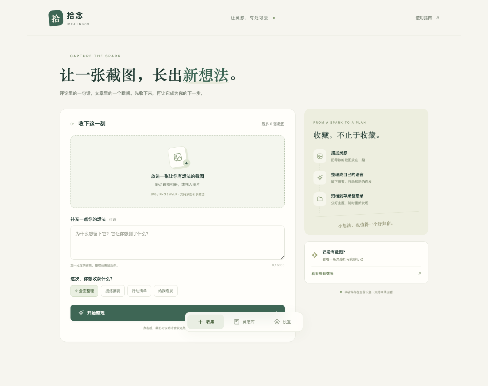

# 拾念 · Idea Inbox

把评论、文章里的截图变成自己的摘要、行动清单与启发，再保存到 **iPhone 苹果备忘录**。

中文、移动优先、可添加到 iPhone 主屏幕的网页 App（PWA）。部署后在 Safari 添加到主屏幕使用，无需苹果开发者会员。GitHub 不会把它变成可直接安装的原生 IPA。



## 已实现

- 选择 1–6 张截图，附加可选文字说明；压缩普通截图，长截图自动按阅读顺序分片。
- 全面整理、摘要、行动、启发四种侧重点，支持 OpenAI 及兼容视觉 API。
- 可编辑标题、摘要、要点、任务、启发、分类和标签。
- 本地草稿恢复、可搜索的灵感库、分类筛选、离线回看、备份导入导出。
- 复制、系统分享和快捷指令交接到苹果备忘录。
- 明确标记的演示模式，无密钥也可以试用界面。

## 本地运行

需要 Node.js 22 或更新版本。生产运行无第三方依赖。

```sh
cp .env.example .env
# 在本地编辑 .env，配置 API 和应用口令
npm start
```

浏览器打开 http://127.0.0.1:8787 。不配置 AI 时可以点「看看整理效果」。

本机测试 AI 时，在「设置」选择「本机 API 密钥」并输入支持视觉的模型、API 地址和密钥。密钥仅保留在这个页面的运行内存中，刷新后需重新输入。

| 环境变量         | 用途                                          |
| ---------------- | --------------------------------------------- |
| AI_API_KEY       | 模型服务密钥，仅服务器可见                    |
| AI_BASE_URL      | 接口基础地址，如 https://api.openai.com/v1    |
| AI_MODEL         | 你账户可用、支持图片输入的模型名称，必须填写  |
| AI_PROTOCOL      | chat（默认）或 responses                      |
| AI_JSON_MODE     | 默认 true；兼容服务不接受 JSON 模式时设 false |
| APP_ACCESS_TOKEN | 自设的随机应用口令，至少 16 位                |
| ALLOWED_ORIGINS  | 前后端分开部署时填写前端来源，多个用逗号分隔  |

可用以下命令生成随机应用口令：

```sh
openssl rand -hex 24
```

服务器代理模式在 App 设置中填写 **APP_ACCESS_TOKEN**，不要填写 AI_API_KEY。该口令默认只在当前打开期间使用，可选存入本机。

## GitHub 与手机安装

把本目录作为独立仓库，例如 shinian；无需包含上级「与神对话」项目。

1. 使用 GitHub Pages 发布静态网页。本应用已包含 Pages 工作流，可在 GitHub Actions 中手动运行。
2. 确认工作流发布出的 HTTPS 页面可打开。
3. 在 iPhone Safari 打开网址，点分享 → 添加到主屏幕；若出现「作为网页 App 打开」选项，打开后添加。
4. 在「设置」填写 AI 基础地址、支持图片的模型名称和 API 密钥，再开始收集。
5. 按应用内「使用指南」连接备忘录快捷指令。

仓库为公开仓库，代码和网页资料会对公众可见。AI 密钥不会写入仓库；整理时会在浏览器内附在请求中并直接发送给配置的 AI 服务。请只在自己的设备使用，不要共享设备。

本机密钥模式依赖 AI 服务允许浏览器跨域请求。OpenAI API 可从网页调用；兼容服务若不支持 CORS，应使用私有服务器代理模式。

其他 Node 托管平台：执行以下命令，让平台通过 HTTPS 转发端口 8787：

```sh
HOST=0.0.0.0 npm start
```

### 私有服务器代理（可选）

需要把 API 密钥留在服务端时，可将仓库导入 Vercel 或其他 Node 托管平台，配置 .env.example 中的服务端变量，然后在 App 设置选择「服务器代理」。费用和资源限制以托管平台为准。

## 苹果备忘录连接

可先从应用内使用指南下载已签名的快捷指令文件（仍需实机检查并选择文件夹）。如果无法导入，按以下两步手动创建。

在 iPhone 备忘录中创建「灵感收集」文件夹，再添加快捷指令 **拾念 · 存到备忘录**：

1. 获取剪贴板。
2. 创建备忘录：内容选上一步剪贴板，文件夹选「灵感收集」。有「显示编写表单」选项时可打开以便确认。

App 中点「存入苹果备忘录」，复制后点「打开快捷指令归档」。快捷指令名称可在设置里修改。是否真的创建成功，请到备忘录确认；App 不会声称已完成同步。

分类写在正文，标签以可搜索的 #文字 保存，待办用 ☐/☑ 表示，不保证自动变成原生标签或原生勾选清单。第一版向 Notes 传递文字，截图保留在本地草稿/灵感库；需要时在备忘录另行添加原图。想分类存不同文件夹，可在快捷指令添加菜单分支。

## 数据与使用边界

- 点击整理时截图和说明会发送给模型服务。本机模式的密钥与图片直接发送给服务商；服务器模式的服务端代码不持久保存内容。浏览器、托管平台与供应商的数据政策仍适用。
- GitHub 仓库和 GitHub Pages 网页内容公开。不要放入不希望公开的信息或敏感截图。
- IndexedDB 保存本地笔记和截图，localStorage 保存文字恢复日志。未加密，共享设备不宜存敏感内容。
- 清除网站数据、更换设备，或切换 Safari 与主屏幕 App，可能无法看到原记录。定期导出备份，将重要内容存入 Notes。
- 每次最多 6 张原图、每张 20 MB、处理后 16 片，请求总大小 3 MB；过长或复杂截图请分批。备份导入最多 50 MB。
- AI 等待上限约 100 秒。取消后供应商可能仍计费；程序不自动重试。
- 每口令每进程每分钟最多 6 次。serverless 多实例不共享计数；多人开放前需加入账号、持久限流与费用预算。
- 未配置真实 API 时，测试用模拟响应验证程序，不代表真实服务已连通。
- 快捷指令导入、权限与实际 Notes 创建仍需 iPhone 实机验收。

## 验证

```sh
npm ci
npm test
npm run check
npx playwright install chromium webkit
npm run test:e2e
```

覆盖输入、长图、响应、访问控制、错误脱敏、静态文件边界，以及手机界面、草稿恢复、保存读取和离线缓存。真实模型 API 和 iPhone Notes 需要另行确认。
